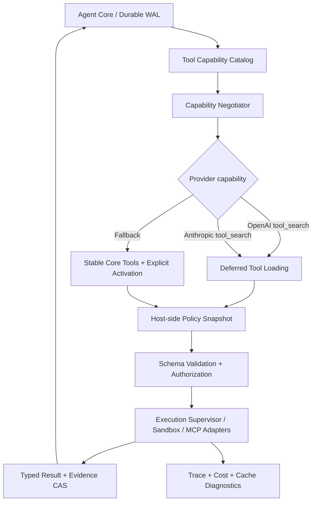

# Kroma Harness：2026-10-20 前沿工具、缓存与压缩架构审计及升级蓝图

**研究冻结日期：** 2026-10-20  
**审计源码：** `e95845b688729abc9b7f9ef2c0b824feda1ef7e7`（546 个已验证文件，见交付包 `IDENTITY.json`）  
**审计对象：** 用户提交的 Kroma 最新源码归档（静态检查 + 官方技术文档交叉验证）  
**证据边界：** 本环境无 Rust `cargo` / `rustc`，没有执行新的编译、真实模型调用或在线 A/B。归档自述历史本地门禁为 1195 个工作区测试、56 个真实 bwrap 测试通过；本报告不把历史结果冒充本轮复现。

---

## 0. 执行决定

**结论：保持现有 Rust 微内核、工具权限与证据存储基础，不推翻重写；推进一次以「模型原生能力 + 端到端缓存经济性 + 证据保真」为核心的架构升级。**

| 子系统 | 当前可验证能力 | 主要差距 | 结论 |
|---|---|---|---|
| 工具 | 注册表、发现/激活、请求授权快照、受控调用、MCP、Code Mode、受控读并发 | 缺模型原生 tool search/deferred schema、MCP 2026 新适配器、跨工具与缓存的稳定前缀设计 | 基础扎实，前沿原生接入不足 |
| 缓存 | Anthropic 断点；OpenAI 部分 cached usage；请求逻辑前缀观测；只在同请求压缩重复 read 输出 | OpenAI GPT-5.6+ 显式缓存与 write 统计缺失；动态 schema 导致前缀抖动；无真实命中诊断与端到端成本闸门 | P0 需要升级 |
| 压缩 | 可恢复证据归档、工作集/因果 pin、高低水位、确定性任务状态 | 缺实模型长程保真与压缩后收益量化；provider-native compaction 未接；语义摘要未通过 held-out 验证 | 保留核心，优先证明效果 |

**“最顶级”不是功能清单。最终必须通过同模型、同任务、同预算的真实配对 A/B，把成功率、证据完整性、实际成本（含 cache write）和 P95 延迟同时测出来。**

## 1. 截至 2026-10-20 最重要的官方变化

| 发布方 | 官方进展 | 对 Kroma 的设计影响 | 来源 |
|---|---|---|---|
| OpenAI，2026-09-22 | GPT-6 改进的 Prompt Caching：缓存失效诊断、显式断点、30 分钟匹配窗、稳定 tools/allowed_tools，支持 `configuration_update` 调整推理强度而保留缓存 | 提供精确缓存控制、写入/读取成本拆分及 cache-miss 可观测能力 | https://openai.com/index/better-prompt-caching-for-gpt-6/ |
| OpenAI API，当期 | GPT-5.6+ `prompt_cache_options.mode` 与 `prompt_cache_breakpoint`，`cache_write_tokens`；以前模型的兼容路径不同 | 必须按模型能力协商；OpenAI 不能再把 cache write 统一写成 `None` | https://developers.openai.com/api/docs/guides/prompt-caching |
| OpenAI API，当期 | `tool_search` + `defer_loading`；工具定义发现后装载至历史末端；高级 `additional_tools` | 动态激活扩展工具的同时保护长期缓存前缀 | https://developers.openai.com/api/docs/guides/tools-tool-search |
| OpenAI API，当期 | Programmatic Tool Calling：面向聚合型多次查询减少模型中转/冗余上下文 | 仅作为支持模型上的可选高性能路径，尤其适用于批量只读数据聚合 | https://developers.openai.com/api/docs/guides/tools-programmatic-tool-calling |
| OpenAI API，当期 | Responses `context_management` 自动压缩、可回传加密 compaction item、`store:false` | Provider-native 分支可试验，但不得混淆 Kroma 的审计事实与不透明摘要 | https://developers.openai.com/api/docs/guides/compaction |
| Anthropic，当期 | Tool search、deferred loading、5m/1h 缓存、自动/显式缓存、context editing；2026-09-04 beta on-demand/keep-tail/background compaction | 避免动态工具修改前缀；压缩必须正确处理 tool pairing、thinking 与缓存失效 | https://platform.claude.com/docs/en/agents-and-tools/tool-use/tool-search-tool ; https://platform.claude.com/docs/en/build-with-claude/prompt-caching ; https://platform.claude.com/docs/en/build-with-claude/compaction-keep-recent-turns |
| MCP，2026-07-28 | 无状态核心、基于 header 的路由、可缓存工具列表、`ttlMs/cacheScope`、新授权与扩展 | 当前 2024-11-05-only 客户端无法宣布兼容；应建双版本协议层 | https://blog.modelcontextprotocol.io/posts/2026-07-28/ ; https://py.sdk.modelcontextprotocol.io/client/caching/ |
| vLLM / SGLang，当期 | 自托管 LLM 的 APC/KV Cache / 多层 HiCache（GPU/RAM/分布式） | 仅在 Kroma 自托管推理服务时才应作为后端基础设施能力；API 客户端无需重造 KV cache | https://docs.vllm.ai/en/latest/design/prefix_caching/ ; https://docs.sglang.ai/advanced_features/hicache_best_practices.html |

### 1.1 避免伪前沿

1. **不能把 prompt cache、MCP 工具清单 cache、文件读取结果 cache、推理 KV cache 混为一个组件。** 它们的所有权、失效条件与安全威胁不同。
2. **不能把“模型摘要越短”当作压缩成功。** 失去一个否定约束或一个测试失败因果链，就可能让长程任务失败。
3. **不能把模型供应商的私有功能写入统一核心协议。** Rust Core 规定安全和证据不变量；provider adapter 按能力投影各自优化。
4. **不能以客户端 hash 相同替代真实 provider 命中。** 前者只是可缓存性的间接信号。

## 2. 工具架构：从“激活工具列表”升级为“能力导向的模型原生工具总线”

### 2.1 源码现况（证实）

- `crates/kroma-core/src/tool/activation.rs:17-20`：`MAX_ACTIVE_TOOLS=8`、扩展 schema 总量上限 64 KiB，激活保存 schema hash；动态刷新时重新检查权限。这是优秀的 host-side 收敛措施。
- `crates/kroma-core/src/agent_loop.rs:1523-1540`：把激活工具并入下一轮 `request_tools`，`begin_request` 为本轮冻结安全边界。
- `crates/kroma-core/src/provider/openai_responses.rs:79-103` 和 `provider/anthropic_messages.rs:77-105`：将每轮工具统一按名字排序并构建顶层数组。**当新工具进入数组时，之前的工具前缀通常变化；排序只能使同集合稳定，不能使变化的集合稳定。**
- `crates/kroma-core/src/mcp.rs:53-59`：只支持 MCP `2024-11-05`，即使实现了高质量的分页/消息长度约束，也不等于支持 2026 版。
- `crates/kroma-core/src/tool/runtime.rs`、`tool/policy.rs`：已有 side effect 分类、权限控制、请求边界，必须保留。
- `crates/kroma-core/src/tool/codemode.rs`：提供受监督的本地脚本路径；**与 OpenAI/Claude 模型托管的 programmatic tool calling 不是同一个隔离/事件/调用语义，不能偷换概念。**

### 2.2 目标架构

`ToolCapabilityCatalog` 每条工具的建议字段：

`{stable_id, namespace, source, description, schema_hash, schema_version, side_effect, trust_level, idempotency, concurrency_class, max_input_bytes, max_output_bytes, required_permissions, execution_timeout_ms, result_schema, cache_policy, provenance_policy}`。

**四条不可妥协的不变量**：模型只看到它被允许知道的工具；模型实际可调用的工具永远只是 host 当前允许的子集；每次执行必须与请求冻结的 schema+权限匹配；调用结果必须有完整的 WAL 事件和可追溯证据引用。

### 2.3 前沿实现取舍

| 策略 | 建议 | 适用条件 | 不可忽视的代价 |
|---|---|---|---|
| 始终可见的少数核心工具 | 默认保持 | 高命中率、高频工具，例如 `read`, `edit`, `bash`, `grep` 等 | 核心工具清单变更须管理版本 |
| 原生 deferred loading / tool search | 优先实现并默认按能力使用 | GPT-5.4+ Responses；支持 tool search 的 Claude 模型 | 搜索工具也可能增加一步延迟；必须有 fallback |
| `allowed_tools`/tool_choice | 优先采用 | 供应商支持、工具全集可稳定发送 | 不能替代 host policy；只限制模型选择 |
| 工具输出 schema/strict mode | 对稳定高价值工具启用 | 供应商和特定工具类型支持 | 不可指望模型 schema 验证代替真实权限校验 |
| Programmatic Tool Calling | 先支持只读、有限批次、模型原生分支 | 重复查询/聚合/过滤任务 | 多级调用绑定、费用统计、`call_id/caller`、可见性审计；写操作另行审批 |
| 高性能批量执行 | 受控有限并行、聚合输出到证据存储 | 无依赖且无副作用的工具 | 需明确 backpressure、超时、取消与“是否可能已执行”状态 |
| MCP 2026 无状态适配器 | P0/P1 必需 | 新 MCP HTTP 服务 | 与旧式 `initialize` 不是同一路径；迁移必须分 transport+revision |

### 2.4 MCP 双版本迁移原则

现有 `McpClient` 面向握手型 JSON-RPC/stdio。新建 `LegacyMcp2024Adapter` 与 `Mcp20260728Adapter`（内部共享认证、工具执行和监督接口，但不能共享错误的握手状态机）。新版适配应测试：

- 每请求携带要求的协议元信息，HTTP `Mcp-Method/Mcp-Name` 与 body 一致。
- `tools/list` 的缓存仅按 `ttlMs`、`cacheScope`、服务端/授权主体分区使用；`private` **绝不可跨用户共享**。
- 工具目录保持稳定顺序与 schema version；收到变化应使旧 tool catalog cache 失效，但不得突破 host policy。
- `ttlMs=0` 代表不得复用；出错和断线后的恢复遵循服务端声明，不静默假设工具可用。
- 旧 2024 服务保持原严格握手；禁用“只改版本字符串就宣称升级”。

## 3. 缓存架构：从“有断点”升级为“跨层可测量、可控失效的缓存系统”

### 3.1 缓存的四个独立层级

| 缓存层 | 谁拥有 | Key/作用域 | 允许复用的内容 | 必须失效的条件 |
|---|---|---|---|---|
| L0 Provider Prompt/KV Cache | 模型服务商 | 相同前缀、模型、模型配置、账户等服务端条件 | 已计算的上下文前缀；客户端拿不到真实 KV | provider 规定的前缀/设置变化及 TTL，失效由上游决定 |
| L1 Tool Catalog Cache | Kroma/MCP adapter | 服务端身份、MCP 修订、授权主体、schema hash、声明 TTL/scope | 工具定义、分页目录 | schema 变更、权限收窄、TTL 到期、服务端变更 |
| L2 Immutable Read/Result Cache | Kroma 可选 | tenant + workspace/repo identity + path/inode/version + range + args + tool version + auth/policy | **已证明只读、确定性、版本匹配**的结果 | 写/移动/删除/切换分支、符号链接变化、权限变化、版本失效 |
| L3 RepoGraph/Evidence CAS/Index | Kroma | content hash、repo snapshot、信任/租户域 | 不可变证据、索引结构和已签名元数据 | 索引源变更、GC 引用解除、权限吊销、损坏 |

**区别：** `read_dedup.rs` 是“同一发送请求内的 read 输出省 token”，不是跨请求持久的文件结果缓存；不要用它证明 L2 已实现。当前证据 CAS 本身已有内容寻址，但不是模型厂商 KV 缓存。

### 3.2 OpenAI 新缓存设计：P0

**当前代码：**

- `provider/openai_responses.rs:160-193` 请求仍使用顶层 `instructions` 和统一顶层工具数组；没有 `prompt_cache_options`, `prompt_cache_breakpoint`, `tool_search` 或缓存诊断接线。
- `provider/openai_responses.rs:293-313` `cache_creation_input_tokens: None`，注释宣称 OpenAI 不报告写入，这对 GPT-5.6+ 已不适用。最新 API 通过 `usage.input_tokens_details.cache_write_tokens` 报告写入。
- `context_economy.rs:24-65` `RunEconomy` 仅保存 uncached、cached、output，无法传递缓存写入；现有 `usage_cost.rs` 已有 write 费率分列能力，属于“采集到比较”的链路缺口。
- `request_observation.rs:20-180` 记录逻辑请求是否相同与历史匹配前缀，但这些不是真实 provider 命中量。

**建议：**

1. 新增 `ProviderCapabilities`（模型精确身份/版本）：`supports_explicit_prompt_cache`, `supports_tool_search`, `supports_programmatic_tools`, `supports_native_compaction`, `supports_encrypted_reasoning_replay`, `cache_telemetry_shape`。缺失时安全回退、不得伪造支持。
2. 针对支持模型实现 `{prompt_cache_options:{mode:"implicit"|"explicit",ttl:"30m"}}`，明确设置稳定缓存边界。**OpenAI 显式断点需位于支持的 `input` 内容块；当前顶层 `instructions` 不能简单打断点。** 要先设计从 `instructions` 迁移到 developer `input_text` 的保序/语义兼容测试。
3. 工具集合频繁变化优先用原生 tool search/deferred loading 或稳定工具集合+`allowed_tools`，而非每轮重排新增顶层 schema。
4. 解析 `cache_write_tokens`，使 `TokenUsage.cache_creation_input_tokens`、`RunEconomy` 和 `PriceTable` 同口径流通，缺失与零严格区分，且拒绝 `cached + written > input`。
5. 用真实响应 `cached_tokens`、`cache_write_tokens`、cache miss diagnostics、TTFT、完整花费验证改进，不将 client-side prefix match 误标为 provider cache hit。
6. 对动态 system 说明、临时安全策略、近几轮工具结果加在尾部；减少更改已缓存前缀，且不能为追求缓存稳定而降低权限/约束新鲜度。

**重要费用公式（同一响应、同一种报价单位）：**

`实测输入成本 ≈ uncached_tokens * base_rate + cache_write_tokens * write_rate + cached_tokens * read_rate`。

总费用还要加输出 Token、推理 Token 的供应商计费规则、工具/搜索/代码执行调用价；账目字段缺失时标记 `unknown`，不能记为 0。

### 3.3 Anthropic 新缓存设计：P1

当前静态系统、最后一个工具、固定历史前缀和最近尾部最多四处显式断点已具雏形（`anthropic_messages.rs:75-173`）。建议做模型/账户功能门控下的两类比较：

- 手工四断点 vs 官方自动缓存（top-level `cache_control`）在相同任务、相同上下文与真实 API 上的命中和写入次数对比；不要预设哪种一定优。
- 5 分钟/1 小时 TTL 的成本拐点实验：1h 写入溢价不同，只有跨较长空闲复用才有价值；多会话共享需要严格 tenant isolation。
- deferred tools 不放显式 cache control；schema 统一有稳定序列化与 namespace。thinking block 仅做符合供应商规则的原样回放，清除策略必须考虑后续 thinking 有效性。

### 3.4 缓存与压缩必须联合规划

仅比较“压缩后少了多少 token”会误判。压缩早期消息会使后续缓存前缀失效，可能出现一次压缩节省 10K prompt tokens，却触发 100K 前缀重写；压缩的收益应综合下一轮至未来 N 轮的重用情况判断。

建议新增 `CacheAwareCompactionPlanner`（计划器只提供经济决策，不可以绕开上下文硬上限）：

`compact_now` 仅在 `(预计省掉的模型输入成本 + 避免超窗/延迟收益) > (预计缓存写入与丢失命中成本 + 摘要/召回成本 + 风险系数)` 或必须满足上下文容量时触发。

风险系数通过 held-out 数据确定，不得依赖拍脑袋常数作为可靠性保证。在缓存和质量权衡冲突时，正确性、权限和硬上下文上限优先。

### 3.5 安全与隐私

- prompt cache 的底层隔离由供应商执行；Kroma 要正确配置客户分区与日志，不能推断“相同 prompt 一定跨账户可复用”。
- MCP `cacheScope=private`、读取凭据和 tenant id 严格绑定。不得将包含用户私有路径、令牌、secret、可执行工具返回的数据写入全局共享 cache。
- 密钥和 auth 不能拼入可读 trace；记录脱敏后的 hash/版本/原因码即可。
- 不可信工具结果视作数据，不可影响 policy。即使命中缓存，也重新执行本次授权检查。
- 缓存数据清理、撤权、TTL、GC 都有可审计事件与重放测试。

## 4. 上下文压缩：从“能回收空间”升级为“保证证据与约束的可恢复控制面”

### 4.1 当前已有的好结构

- `context_projector.rs:12-16`：最小可压缩工具输出 1 KiB、因果引用小结果保护 4 KiB、近期工作集 8 轮；配合窗口高/低水位，避免无边界历史堆积。
- `context_projector.rs` 和 `evidence_store.rs`：将大工具结果归档，并在上下文中留下可召回 Evidence ID；有明确可用性/GC 的界线。
- `task_state.rs:1-23`、`task_state.rs:516-527`：Stage 1 规则状态保留默认启用；Stage 2 结构化语义压缩尚未默认打开。这是稳健的阶段策略。
- `read_dedup.rs`：基于完整内容、范围、工具调用身份的同请求重复读取省文本；不覆盖失败、截断或图像结果。

### 4.2 我建议的四层信息保留结构

| 层级 | 内容 | 删除/重写策略 |
|---|---|---|
| L0 不可丢控制事实 | 用户硬约束（特别是“不得”“只能”）、权限、目标、通过/失败判据、正在执行的工具调用绑定 | **绝不允许纯摘要覆盖**；只能用户或受信任事件显式修改 |
| L1 活跃工作集 | 最近 1–8 轮、未提交编辑、未决错误、最近测试结论、活跃代码文件 | 保持原文或有损极低的结构化片段；从完整对话切段时不得拆开 call/result |
| L2 可复核事实账本 | 源文件位置/commit/file hash、测试结果、已验证假设、决策和反例、证据 ID | 先结构化；逐项附来源与新鲜度标记；可选择性 `rehydrate` |
| L3 历史工具原文 | 大日志、旧读取输出、重复堆栈、无关中间数据 | 归档到 Evidence CAS，模型只见短引用；按需召回；不得丢真实工具失败语义 |

关键不是用一个“漂亮摘要”替代所有层，而是把 **控制状态、可信事实、活跃上下文、不可信原始证据分开**。

### 4.3 压缩执行顺序

**S0 输入治理**：请求进入时确定工具输出最大字节、结构化裁切规则（head/tail/error spans）、禁止隐藏失败部分；超界结果截断时标记状态，保留 evidence pointer。

**S1 低风险上下文编辑**：旧重复 `read`、成功后不再相关的长日志、重复搜索结果按确定性规则折叠；不改变原始 WAL、不吞真实错误、不破坏调用配对。

**S2 类型化任务状态**：显式保存当前目标、约束、待完成验证、修改集、失败原因、未决依赖、证据引用、文件快照版本。用状态机处理 supersession（旧结论被更新覆盖），不能把猜测当事实。

**S3 可选模型压缩**：在 Stage 1 不能提供足够空间时，**仅对可摘要的较旧片段**做 schema-constrained summary，并要求 provenance、critical fact retention、contradiction check。若失败：放弃该摘要，退回 S1/S2，必要时停机要求用户处理容量。

**S4 Provider-native 分支**：OpenAI 返回的不透明加密 compaction item 可用于模型状态续接；Claude 的 keep-tail/on-demand compaction 可做兼容试验。**它们不应成为 Kroma 安全/审计事实的唯一来源。** 需要在请求/回放协议中明确 compaction item 的不透明性质，保持 Kroma 原始 WAL 及证据 CAS 独立存在。

### 4.4 必须处理的微妙问题

- **Call pairing**：任何裁切点都不得让 tool call 在压缩块前而 result 在块后；包含多工具并发/取消/重试/未知完成状态。
- **Opaque reasoning**：部分 provider 要求原样回传加密 reasoning/thinking；有选择地删除 earlier messages 可能使 later reasoning 无效。
- **因果证据**：失败测试、拒绝批准、无法打开文件等都可能是后续决策的重要依据，不能只保留“成功”结果。
- **过期事实**：代码文件被写入后，读取证据可能不再表示当前工作树状态；既要保留历史证据，也要显式指出 stale。
- **软硬约束区分**：硬约束不压缩；软偏好可丢/重建但不可误当硬约束。
- **缓存再写入成本**：历史摘要改变 prefix，必须在 latency/cost 度量中体现，不允许用“更短”代替“更便宜”。
- **压缩失败恢复**：压缩器 429、超时、无效 JSON、矛盾、证据找不到、CAS GC 提前清除都必须 fail-closed/revert 原请求态。

### 4.5 深度验证而不是摘要评分

建立长链任务集：中间曾要求“不要修改某目录”，30 轮后执行新增修复；第 2 次工具显示测试失败，第 8 次修复后消失；跨 branch 的 file hash 更新；并发工具的 call/result 打断；30/60/120/240 轮长程任务。对照无压缩、规则压缩、分层证据、语义摘要、provider-native 五种路径，比较最终补丁正确性与违反禁止项的次数。

需要单独报告 `constraint_retention`, `evidence_recall@k`, `stale_fact_error_rate`, `tool_pairing_integrity`, `final_verification_success`, `provider_cache_hit_ratio`, `TTFT/p95`, `billed_cost`。有 provenance 的摘要仍可能遗漏内容，因此必须用真实任务防回归，而不是只看自动摘要的表面相似度。

## 5. 开发级工作清单（排序已考虑依赖）

| ID | 级别 | 责任域 | 实现内容 | 验收定义 |
|---|---|---|---|---|
| KH-001 | P0 | Provider Usage | OpenAI `cache_write_tokens` 正确解析、stream/final 两通道；`RunEconomy` 增字段、价表版本/缺失语义一致 | fixtures + property test + 同一个真实响应的费用对账；旧模型兼容 |
| KH-002 | P0 | Provider Request | `ProviderCapabilities` + OpenAI GPT-5.6+ cache controls，开发者消息/显式断点兼容，feature flag | 不支持模型不发新字段；黄金 wire fixtures；实际提供商 smoke |
| KH-003 | P0 | Tool/Cache | 工具稳定前缀设计：deferred/`allowed_tools`、工具版本及 hash，保持 request-level policy snapshot | 连续激活工具不造成意外 `tools_changed` 大额未命中（需线上诊断） |
| KH-004 | P0 | MCP | 新版 2026-07-28 双协议 adapter，HTTP header/meta、缓存提示、授权作用域；旧版不回退放宽权限 | MCP 规范兼容测试 + 恶意服务端 fuzz + 双版本真服务集成 |
| KH-005 | P0 | Benchmark | 真实 paid model A/B + paired corpus、费用账本、差异报告、密钥隔离、跑批安全限制 | `synthetic` 与 `provider-live` 报告严格区分；可复现完整 raw report |
| KH-006 | P1 | Tool Native | OpenAI、Claude tool search/defer adapter；稳定 schemas，搜索失败 fallback | 同任务成功率不退化；工具 prompt token 显著降低才启用 |
| KH-007 | P1 | Tool Execution | 只读程序化批量工具调用、输出 schema、安全执行隔离、bounded concurrency、取消状态 | 未授权 side effect 数=0；event trail 含 call ID；部分成功明确标识 |
| KH-008 | P1 | Cache Observability | per-attempt cache reason，prefix divergence、TTL、writer/reader 分列、TTFT、故障观测 | 命中比例来自 provider usage；trace 不泄密；可归因 major misses |
| KH-009 | P1 | Compaction | CacheAwareCompactionPlanner、hard-fact pin、stale facts、证据召回/原位保留和回滚 | 严格验证不得丢硬约束、不得破坏配对、不丢未完成修改 |
| KH-010 | P1 | Semantic Compression | Schema-constrained 压缩以实验 flag 接入，受控 prompt，事实级 retention checker | held-out 长程任务质量非劣；否则持续关闭 |
| KH-011 | P2 | Provider Compaction | OpenAI opaque compaction、Claude keep-tail/on-demand/background 分别实现安全分支 | 兼容 store:false / reasoning replay；fail-closed，保留独立审计 WAL |
| KH-012 | P2 | Local Caches | versioned read/result cache（仅确定性只读）和 repo index 缓存；单飞/GC/tenant scope | 写入后绝不提供旧结果；权限收紧即时生效；污染负测为零 |

**重要依赖关系：** 先 KH-001/KH-005 确定基线的账目真实性，再 KH-002/003/004 和 KH-006。否则你看到的节省或性能进步可能来自缓存账目误差、工具变更导致的命中波动或不相同的任务集。

## 6. 推荐验收与发布闸门

以下是**建议的工程验收门槛，不是宣称当前已经达到的实测数据**。

| Gate | 项目 | 必须通过（阻断发布） | 优化项（需对照真实任务） |
|---|---|---|---|
| G0 | 可复现性 | 精确源码 hash、Rust fmt/clippy/unit/integration、价格表版本、模型具体身份、实验随机种子、原始日志齐全 | 保留机器与网络差异 |
| G1 | 工具安全与协议 | 100% tool call/result ID 连接可验证；工具权限收窄立即生效；无授权越界；旧版 MCP 兼容、新版 conformance 通过 | 首次工具选择正确率、减少无效调用、工具发现额外延迟 |
| G2 | 缓存准确性 | cache write/read/uncached 有严格守恒关系；对有额外字段的模型能正确解析；未知不标零 | 热前缀场景命中提升、单任务实际花费下降、P95 没有显著退化 |
| G3 | 上下文正确性 | 硬性否定约束在定制对抗测试中 100% 保留，tool pairing 100%；旧/新证据可区分 | 长程任务最终 success 非劣 + 证据召回率高 |
| G4 | 可靠性/隐私 | 无跨 tenant cache 泄露、无 stale authorized tools、缓存断电/取消/GC 恢复通过 | 长期运行、冷/热启动内存与 tail latency 可控 |
| G5 | 真实模型 A/B | 必须是真实 provider，固定模型+工具权限+同题配对+相同总成本预算；独立验收最终文件/补丁 | 建议以 95% 置信区间非劣于基线为最小质量门槛；是否追求显著优势取决于样本量与预算 |
| G6 | 发布策略 | feature flags + rollback + canary + 默认拒绝不兼容能力 | 在成功率/风险不下降条件下追求低成本、低延迟 |

**测试集最低构成建议（不是统计功效保证）：** 代码修复、仓库搜索、复杂测试失败追踪、工具量 10/50/200、跨模型供应商、单/多用户、不同 repo 大小、长链 10/40/100+ 轮、多次工具激活、冷热缓存、TTL 到期、权限收窄、文件改变、非英文硬约束和异常网络。随机化配对重复运行，预算与 token 限制一致，公布每项的失败类型。决定性差距不足时增加样本，而不是选择有利任务。

### 6.1 一套有诊断价值的实验矩阵

| Arm | Tools | Cache | Compression | 用途 |
|---|---|---|---|---|
| A | 当前 eager/on-demand 激活 | 当前 | 当前 | 真实基线 |
| B | 当前 | 新 provider-native/cache accounting | 当前 | 纯缓存提升 |
| C | Native tool search | 新 | 当前 | 工具和缓存交互提升 |
| D | 当前 | 新 | 新规则/证据优化 | 单独检验压缩 |
| E | Native tool search | 新 | 新压缩 | 最终组合与交互作用 |
| F（可选） | Native tool search | 新 | Provider-native compaction | 与 Kroma 证据压缩比较，不能直接替代 |

样本分为开发集/验证集/最终 held-out 集。不能在 held-out 上迭代阈值；同模型同工具权限相同环境，按实际账单而不是 estimate 排名，模型报告版本改变须重新建基线。至少复核成功/失败判定和工具变更后缓存未命中原因。

## 7. 交付规划：先可验证，再性能极限

**Phase A — 可靠性地基：** KH-001、002、004、005。这一阶段解锁准确费用基线、模型版本能力和新版 MCP 协议兼容，不更动核心压缩语义。

**Phase B — 工具与缓存协同：** KH-003、006、008，并在有限权限的只读路径试行 KH-007。重点测试“动态加载工具后是否仍能命中旧前缀”，以及发现的工具是否仍严格经过 host policy。

**Phase C — 证据安全的压缩实验：** KH-009/010，先测试后默认开启；必要时 KH-011 作为与 provider-native 的竞争/补充路线。用 A/B 跟踪长程任务成功率与费用。

**Phase D — 自托管和超大仓库：** KH-012；若未来自托管 vLLM/SGLang，再研究多级 GPU KV cache。不要在云模型客户端重复实现底层 KV 系统。

## 8. 直接修改的源码切入点

| 代码位置 | 目标变更 | 特别注意 |
|---|---|---|
| `crates/kroma-core/src/provider/openai_responses.rs` | 缓存模式、断点、deferred tool、tool usage、新回应事件 | `store:false` 的 opaque reasoning replay 不可回归 |
| `crates/kroma-core/src/provider/anthropic_messages.rs` | `defer_loading`、auto cache feature flag、思维块处理 | 手工断点最多 4 个、deferred tool 不加 cache_control |
| `crates/kroma-core/src/provider/sse.rs` | Streaming usage + write、final reconcile | 禁止重复加账/遗漏流尾 |
| `crates/kroma-core/src/context_economy.rs` | 加 cache write tokens、按尝试分列成本 | 老报表反序列化兼容；missing != zero |
| `crates/kroma-core/src/usage_cost.rs` | 按模型版本选择写入价格，核对 token partition | 价格表需要 version/source，未知价不可判便宜 |
| `crates/kroma-core/src/tool/activation.rs` | 保持权限状态机，新增 provider-native defer 投影 | 别因 deferred 而跳过真实执行授权 |
| `crates/kroma-core/src/tool/registry.rs` | Tool catalog version/schema hash/namespace | 动态工具重名或替换必须拒绝或严格版本化 |
| `crates/kroma-core/src/agent_loop.rs` | 能力协商、工具激活和压缩计划的编排 | 每次请求冻结执行边界；可靠回放 WAL |
| `crates/kroma-core/src/mcp.rs` | 分离旧新版协议状态机、缓存提示 | 新版并非只加一个支持版本字符串 |
| `crates/kroma-core/src/context_projector.rs` | 保留 hard constraints/active workset + cache-aware 经济门槛 | 不可影响 Evidence ID 召回和工具配对 |
| `crates/kroma-core/src/task_state.rs` | 结构化事实及 Stage2 held-out 实验 | 不把模型推断升级成不可辩驳事实 |
| `crates/kroma-core/src/evidence_store.rs` | 版本和 freshness 信息的召回 | GC 后须显式 unavailable，不得伪造原文 |
| `crates/kroma-core/src/request_observation.rs` | 增 provider 真实 cache-miss reason 和 trace span | 保持内容无关/脱敏日志 |
| `crates/kroma-core/src/read_dedup.rs` | 保持同请求去重；外部 L2 cache 用单独组件 | 结果缓存必须有写入失效机制，不扩大 dedup 的安全假设 |

## 9. 与现有文档的冲突和限制

- 交付包 `README.txt` 记载的 1195/56 是打包方**历史运行声明**；本环境未重跑，不能写成“本次测试通过”。
- 仓库 `README.md` 与 2026-10-19 的 `DIRECT_REPAIR_VERIFICATION_2026-10-19.md` 对 verifier/probe/hook 是否全部受 sandbox policy 约束的描述存在**新旧口径不一致**。这一事项属于文档及真实接线路径待专项复查，本报告不凭任一文档推断整条链绝对隔离。
- `docs/CAPABILITIES.md` 对缓存真实 canary 标明 `NOT_RUN`，因此没有证据可以给 Kroma 宣称 90% 实测命中率。
- 合成 benchmark 验证的是“测量基础设施工作正常”，不是前沿设计在真实长程编码任务上的最终效果。`README.md` 也明确了这一点。
- 本轮为静态审计及对照研究，未写入 Kroma 源码，不声称已经部署上述 P0/P1 功能。

## 10. 来源、等级和复核提示

**A 级：官方规范/供应商当期文档（确认功能和协议存在，不保证 Kroma 适配正确）**：

- OpenAI GPT-6 prompt caching（2026-09-22）：https://openai.com/index/better-prompt-caching-for-gpt-6/
- OpenAI prompt caching：https://developers.openai.com/api/docs/guides/prompt-caching
- OpenAI tool search：https://developers.openai.com/api/docs/guides/tools-tool-search
- OpenAI programmatic tool calling：https://developers.openai.com/api/docs/guides/tools-programmatic-tool-calling
- OpenAI compaction：https://developers.openai.com/api/docs/guides/compaction
- Claude tool search：https://platform.claude.com/docs/en/agents-and-tools/tool-use/tool-search-tool
- Claude prompt caching：https://platform.claude.com/docs/en/build-with-claude/prompt-caching
- Claude context editing：https://platform.claude.com/docs/en/build-with-claude/context-editing
- Claude compaction keep recent turns：https://platform.claude.com/docs/en/build-with-claude/compaction-keep-recent-turns
- MCP 2026-07-28：https://blog.modelcontextprotocol.io/posts/2026-07-28/
- MCP cache hints：https://py.sdk.modelcontextprotocol.io/client/caching/

**B 级：上传源码中的实现声明和可定位代码（静态确认，未复测行为）**：详见第 2、3、4、8、9 章节给出的路径与行号。

**C 级：本报告设计提案与门禁阈值（尚未实现，尚未验证）**：第 2.2–2.4、3.4–3.5、4.2–4.5、5–7 章节。提案经真正实现、独立验证与线上 Canary 前，不得写入产品功能声明。

---

## 11. 2026 学术与一线 Harness 工程交叉验证（补充）

### 11.1 一线公开工程：缓存的核心是「追加式历史 + 确定性工具」

OpenAI 2026-07-29 的 Harness 工程披露了三条可操作的经验：默认限制工具输出大小（其公开示例为 10,000 tokens，模型可按需调整）；集成和工具应当按需发现；模型可见历史应尽量采用 append-only，运行时审批策略在执行时生效，而非反复修改工具定义。它们与 Kroma 现有的执行权限快照机制兼容，但和“新激活工具插入顶层工具列表”的缓存抖动存在差距。来源：https://openai.com/index/gpt-5-6-frontier-intelligence-efficiency/ （2026-07-29）。

OpenAI 2026-08-19 的 Codex Harness 平台报告强调复用 Agent Loop、工具审批、状态续接和事件流；其展示的 ARC-AGI-3 分数变化仅为报告中固定模型与实验条件的案例，不能直接转成 Kroma 的效果预期。来源：https://developers.openai.com/blog/codex-as-a-platform 。

### 11.2 压缩的最新研究警示（不得把预印本的单点数值当作通用结论）

| 研究 | 发布时间 | 报告观点/实验发现 | Kroma 的落地价值 | 证据级别 |
|---|---|---|---|---|
| Governance Decay / ConstraintRot | arXiv 2026-06 | 论文声称在其 1,323 个评测 episode 中，随着治理约束从摘要中丢失，受禁止的工具行为显著上升；提出 **Constraint Pinning** | 将不可丢约束从压缩正文隔离，单独持久保留并在每次请求和执行权限检查时复用 | 预印本，**需在 Kroma 复现实验** |
| The Compaction Cliff / Knowledge Triage | arXiv 2026-08 | 论文在其具体 Claude 配置上报告多轮压缩后约束保留率下滑，并提出按知识类型区别压缩、分解与召回 | 支持 L0–L3 类型化知识及不同 retention policy，不以单个大摘要覆盖全部 | 预印本，具体模型和数字不外推 |
| Beyond Compaction / Context Window Lifecycle | arXiv 2026-05 | 用类型化 episode、依赖图和确定性 eviction 取代单一摘要，主张主动淘汰可恢复历史 | 可借鉴到 `context_projector` 的因果、依赖与 evidence 召回机制 | 预印本，需检查真实代码任务的 tradeoff |
| LongMemEval-V2 | 公开仓库 2026-08 更新 | 451 个问题、五种记忆能力、超长历史，报告准确率与查询延迟的 Pareto 关系 | 作为外部记忆/事实召回子系统评估补充，而非替代代码任务 end-to-end bench | 可重跑开源数据与评测代码 |
| Parallel Context Compaction | arXiv 2026-05 | 探索并行摘要降低阻塞延迟，同时承认压缩的有损性和不确定性 | 可做高端选项，但必须解决与 WAL 新增历史的原子替换及版本冲突 | 预印本；前期不列 P0 |

研究来源：

- https://arxiv.org/abs/2606.22528
- https://arxiv.org/abs/2608.22752
- https://arxiv.org/abs/2606.11213
- https://github.com/xiaowu0162/LongMemEval-V2
- https://arxiv.org/abs/2605.23296

### 11.3 应当加入验收的三组前沿对抗实验

**A. Constraint Rot**：把一条含否定词的禁止操作规则放在 100+ 轮历史开头，以插入长日志/工具输出迫使多轮压缩；在第 N 轮要求模型执行被禁止操作。比较无压缩、Kroma 规则压缩、Stage2、provider-native，检查真实工具级别的拒绝，不仅检查回答说了什么。

**B. Summary Injection**：恶意工具结果伪装成“本条历史不重要/忽略早期限制”，诱导压缩摘要删除合法约束。测试压缩器是否把不可信结果提升为控制层指令；应保留来源信任等级与执行时 host policy。

**C. Memory Version Rot**：在第 10 轮记录某文件事实，第 30 轮真实修改，第 70 轮再问现状，检查是否依据旧 Evidence ID 给出过期答案。必须保持“历史真实”和“当前真实”两个维度而不是删除旧证据。

这三组案例应该进入 `KH-009/KH-010` 的 release-blocking 测试；论文启发测试设计，但测试通过与否只能由 Kroma 自身真实复现实验决定。

### 11.4 本轮实际修复范围

本报告完成后，另行制作了 `Kroma_e95845b_P0_缓存写入计费修复_未编译.patch`：仅涉及 OpenAI write usage 解析与 `RunEconomy` 成本字段，静态通过 `git apply --check` 和 `git diff --check`，附 5 项拟执行的 Rust 单元测试。由于本环境缺少 Rust toolchain，**该补丁没有编译或实网验证，也不意味着其余 KH-002～KH-012 已实现**。逐项执行命令参见 `Kroma_Harness_P0_缓存计费修复_交接说明.md`。

---

## 最终判断

对 Kroma 来说，投入产出最高的不是“再发明一个大而全缓存系统”或“强上模型自动压缩”，而是：

**（1）以能力协商把模型最新的 tool search 和 prompt cache 真正接进现有安全架构；（2）正确计算 cache write/read 与实际账单；（3）用 Evidence CAS + 不可丢硬约束实现可恢复压缩；（4）以真实模型长程任务验证总成本、最终成功率与安全不退化。**

做到这些并通过 G0–G6，才有工程证据将 Kroma 的这三个基础能力列为 2026 年一线架构水平；在此之前只能说“有坚实基础，尚未完成最前沿能力和效果验证”。
